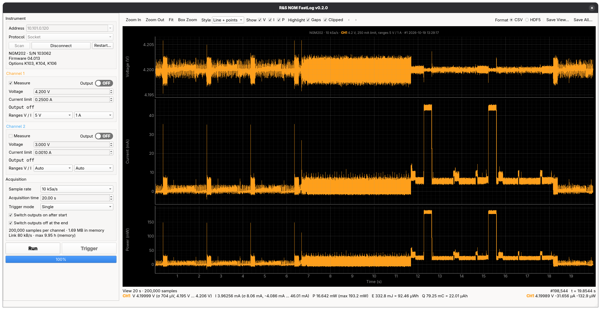

# R&S NGM FastLog

GUI for high-speed voltage and current logging (up to 500 kSa/s) with a Rohde & Schwarz
NGM201 or NGM202 power supply over LAN. It controls the supply (setpoints, outputs,
measurement ranges), streams FastLog data from one or both channels while the capture runs,
and plots voltage, current and power with zoom, statistics and save.

Release notes are in [CHANGELOG.md](CHANGELOG.md).



## Setup

```sh
uv sync                      # creates .venv with the exact versions pinned in uv.lock
uv sync --extra test         # also installs pytest
```

Dependency versions are pinned:

- **`uv.lock`** pins every package, including indirect ones, with hashes.
- **`.python-version`** pins Python 3.14.
- **`pyproject.toml`** lists the minimum versions this was tested with.

To move to newer releases, run `uv lock --upgrade` and then `uv sync`, retest, and commit
the updated `uv.lock`. Without uv, `python -m venv .venv && .venv/bin/pip install -e .` also
works, but it installs the newest compatible versions rather than the pinned ones.

The instrument is driven with Rohde & Schwarz's [RsInstrument](https://rsinstrument.readthedocs.io).
The default protocol, Socket (port 5025), uses RsInstrument's built-in socket I/O, so no VISA
installation is needed. HiSLIP and VXI-11 go through pyvisa-py.

## Run

```sh
.venv/bin/ngm-daq                           # or: .venv/bin/python -m ngm_daq
.venv/bin/ngm-daq --resource 10.101.0.120
```

1. Enter the NGM's IP address (or a full VISA resource string), or press **Scan**. Keep the
   protocol on Socket unless you have a reason not to, then press **Connect**. Connecting
   only reads: the channel panels show the instrument's setpoints, output states and ranges,
   and nothing is sent until you change a control. Until then they show "—".
2. In each **Channel** panel:
   - **Voltage** and **Current limit** are sent when you press Enter or leave the field,
     and only if you changed them. The mouse wheel only adjusts a field you have clicked into.
   - The **Output** switch shows whether the output is OFF or ON; click it (or press Space)
     to switch the output.
   - The readout shows the measured voltage, current and power, and CV/CC. A tripped
     OCP/OVP/OPP/OTP shows in red.
   - **Ranges V / I** set the measurement ranges: 5 V or 20 V; 10 mA, 100 mA, 1 A or 10 A;
     or Auto, applied when you choose them. Use a fixed range when you can (see Clipped
     readings below).
   - **Measure** includes the channel in captures.

   Setpoints and outputs stay live during a capture, so you can step the voltage or switch
   an output while logging. The panels also follow changes made on the instrument's front
   panel, within a second.
3. In **Acquisition**, choose the sample rate (100 Sa/s to 500 kSa/s per channel; both
   channels together are limited to 500 kSa/s, so 250 kSa/s each), the acquisition time and
   the trigger mode:
   - **Single:** Run takes one capture. Stop part-way to keep what was recorded.
   - **Auto (continuous):** captures follow each other without a gap until **Stop**. If you
     stop part-way through a capture, the last complete one stays on screen.
   - **Manual:** Run arms FastLog; each **Trigger** press (F6) takes one capture, then it
     re-arms until **Stop**.

   **Switch outputs on after start** switches on the measured channels' outputs once FastLog
   delivers its first data. The capture then shows about 0.6 s of baseline, the turn-on and
   the inrush. **Switch outputs off at the end** switches them off when the run ends.
   The acquisition time is limited by memory; the summary line shows the limit.
4. Press **Run** (F5). Data plots live as it arrives, in stacked voltage, current and power
   plots that share the time axis (CH1 orange, CH2 blue, as on the instrument).
5. Zoom with the toolbar buttons, the mouse wheel, or **Box Zoom**, and use **Show V I P** to
   pick the plots. The statistics under the plots cover the displayed window: mean, σ, min
   and max of V, I and P, energy (J and Wh) and charge (C and Ah). The cursor readout shows
   the sample under the mouse. **Style** selects Line, Line + points (markers once samples
   are 3 px apart) or Points.
6. **Highlight** shades two kinds of problem samples. Bands are at least 3 px wide so a
   single sample stays visible, and **◀ ▶** jump between them:
   - **Gaps (red):** samples that never reached the PC (see Lost data below). They are
     stored as NaN.
   - **Clipped (amber):** readings beyond the measurement range. The value is pinned at the
     range limit, so the true value is unknown.

   A warning bar summarises both, with a hint (for example "choose a range above 100 mA").
7. **Save View…** writes the displayed samples; **Save All…** writes the whole capture.
   **Format** chooses CSV or HDF5 (see below).

If FastLog stops with an internal error (see below), the error dialog offers **Restart
Instrument**; the **Restart…** button does the same at any time. The instrument reboots in
about 40 s and the app reconnects.

App preferences (acquisition settings, plot options, which channels to measure) and recent
addresses are remembered between sessions. Channel settings are not: they always come from
the instrument.

## Saved files

| | CSV (`.csv`) | HDF5 (`.h5`, `.hdf5`) |
|---|---|---|
| Contents | `time_s`, then `chN_voltage_V`, `chN_current_A`, `chN_flags` per channel, after `#` metadata lines | Group `chN` per channel: float32 datasets `voltage` and `current`, and `[start, stop)` runs `missing`, `voltage_clipped`, `current_clipped`; metadata as attributes |
| Values | 7 significant digits | Exact: the instrument's float32 values, losslessly compressed (gzip + shuffle) |
| 30 s at 500 kSa/s (15 M samples), one channel | 508 MB, 14 s to write | 58 MB, 1.6 s to write |
| Opens in | Anything | h5py, MATLAB (`h5read`), HDFView, `h5dump` |

`chN_flags` is a bitmask: 1 = voltage clipped, 2 = current clipped, 4 = missing (voltage and
current are NaN). Power isn't stored; it is voltage × current.

HDF5 files don't store a time column, because samples are evenly spaced. Rebuild it from the
`t0_s` and `sample_interval_s` attributes; `t0_s` is non-zero for a **Save View** slice. The
files use the modern HDF5 format, readable by HDF5 1.14 and later.

```python
import pandas as pd
df = pd.read_csv("capture.csv", comment="#")

import h5py, numpy as np
with h5py.File("capture.h5") as f:
    v = f["ch1/voltage"][...]
    i = f["ch1/current"][...]
    t = f.attrs["t0_s"] + np.arange(len(v)) * f.attrs["sample_interval_s"]
    meta = dict(f.attrs)          # instrument, serial, start time, rate, ...
    ch1 = dict(f["ch1"].attrs)    # setpoints and ranges at the start of the capture
```

## How it works

FastLog with the SCPI target collects 0.25 s of samples and offers them as one chunk; every
250 ms the chunk is replaced by the next one. `ngm_daq/instrument.py` configures and starts
it, and `ngm_daq/worker.py` reads the chunks on a dedicated thread:

```
per channel:  SENS:VOLT:RANG / SENS:CURR:RANG (or :AUTO 1)
              FLOG:TARG SCPI; FLOG:SRAT S500k ... S100;  FLOG:STIM? (sample interval)
              STAT:OPER:INST:ISUM<n>:ENAB/PTR 4096       (bit 12: FastLog data available)
start:        one channel:  INST OUT1; FLOG 1
              two channels: FLOG:TRIG 1 on each, then *TRG (both start on the same sample)
loop:         STAT:OPER:INST:ISUM1:EVEN?;:STAT:OPER:INST:ISUM2:EVEN?    every ~4 ms
              INST OUTn;:FLOG:DATA?                      binary block of float32 (V, I) pairs
stop:         FLOG 0; FLOG:TRIG 0
```

Measured on an NGM202 (firmware 04.013) over 100 Mbit LAN:

- A 500 kSa/s chunk is 1 MB and takes about 95 ms to transfer, so one channel at 500 kSa/s,
  or two at 250 kSa/s, uses about 40 % of the link. Polling the status registers rather
  than `FLOG:DATA?` itself keeps transfers about 30 % faster.
- Socket, HiSLIP and VXI-11 perform the same.
- A 30 s, 15 M-sample capture at 500 kSa/s arrived complete while the plot was zoomed and
  panned throughout. Full-capture statistics took 0.17 s and a redraw 22 ms.

**Lost data.** A chunk that isn't read within 250 ms is replaced, and the instrument gives no
error or status flag for it. Chunks arrive exactly every 250 ms with exactly rate × 0.25 s
samples, so the app works out from the time between chunks how many were lost. It inserts
that many NaN samples, so later samples keep their correct times and the gap is shown
where it happened. The instrument thread only waits on the instrument, so a busy GUI
doesn't cause loss; a stalled PC or network can.

**Clipped readings.** Out-of-range readings are not NaN: they are pinned at about 1.13–1.14 ×
the range (the 10 mA range reads at most ±11.34 mA). With a fixed range, readings at or
beyond 1.12 × range are flagged. With autorange the range in use isn't known, so a reading
is flagged when it sits at a lower range's limit and repeats the same value for at least 3
samples. That catches the ~20 µs a range stays clipped before autorange switches up, but
not a real signal passing through that level.

**Plotting.** A 500 kSa/s capture holds 30 million samples per minute per quantity. The
plots don't hand those to pyqtgraph: each channel keeps min/max summaries at several
resolutions as data arrives, and a redraw takes one min/max pair per pixel column (or the
raw samples when zoomed in), so it costs the same at any capture length.

**Instrument quirks the app works around** (NGM202, firmware 04.013):

- **Combined rate limit.** If FastLog runs on both channels at more than 500 kSa/s combined
  (e.g. 500 + 500), the instrument shows "FastLog - Channel 1: Internal critical error -23.
  FastLog disabled." on its display, not in the SCPI error queue. FastLog then stays off on
  both channels, even after you dismiss the message, until the instrument restarts. The app
  never configures such a combination, and it stops FastLog on both channels before every
  run, in case it was left running from the front panel.
- **`*TRG` alternates.** Each `*TRG` toggles an internal FastLog-enable state that `FLOG 0`
  doesn't reset, so after a triggered capture the next `*TRG` does nothing. The app checks
  `FLOG?` after triggering and triggers once more if needed.
- **Settings after a stop.** Right after `FLOG 0`, `FLOG:TARG`/`FLOG:SRAT` can fail with -221
  "Settings conflict"; the app retries.
- **Nagle delay.** Channel select and query are sent as one message (`INST OUT1;:FLOG:DATA?`);
  two separate writes wait about 40 ms for TCP delayed ACK.
- **Other triggered functions.** `*TRG` also fires anything else set to "Triggered" (output,
  arbitrary waveform, data logging). The app refuses to start if any of those is enabled,
  rather than switching an output unexpectedly.
- **Output-on trigger.** Triggering FastLog from "output on" starts too late to see the
  turn-on, hence **Switch outputs on after start**.

`instrument.py` and `capture.py` have no GUI dependency, so you can use them from scripts or
notebooks:

```python
import time
from ngm_daq.instrument import ChannelSetup, FastLogConfig, NgmPowerSupply, SampleRate

with NgmPowerSupply("TCPIP::10.101.0.120::5025::SOCKET") as psu:
    cfg = FastLogConfig((ChannelSetup(1, voltage_range=5.0, current_range=0.1),), SampleRate.R500K)
    interval = psu.prepare_fastlog(cfg)
    psu.arm(cfg.channel_numbers)
    psu.start(cfg.channel_numbers)
    chunks, t0 = [], time.monotonic()
    while time.monotonic() - t0 < 2.0:
        for ch in psu.poll(cfg.channel_numbers):     # poll well within every 250 ms
            chunks.append(psu.fetch(ch))             # (n, 2) float32: volts, amps
        time.sleep(0.005)
    psu.stop_fastlog(cfg.channel_numbers)
```

## Simulator and tests

`tools/ngm_simulator.py` emulates the instrument's SCPI subset over a raw socket, including
the chunk timing (a slow client loses data), the `*TRG` toggle, the rate-limit lockup, and a
Bluetooth-device-like load on CH1:

```sh
.venv/bin/python tools/ngm_simulator.py          # add -v to log every message
.venv/bin/ngm-daq --resource TCPIP::127.0.0.1::5025::SOCKET
```

`uv sync --extra test && .venv/bin/pytest` runs the unit tests, and the worker and main
window against the simulator, in about 35 s. (A plain `uv sync` removes pytest again.)

## Notes

- **Measurement ranges** need the K104 option. Without it the app leaves the ranges on Auto.
- **FastLog to USB.** If FastLog was set to write to a USB stick on the front panel, the app
  switches that channel's target to SCPI when it runs.
- **Front panel.** The front panel stays usable while the app is connected; changes made
  there show up in the channel panels within a second.
- **Restart.** Restarting the instrument switches its outputs off.

## Future development

- **External trigger.** The K103 Digital I/O option can start FastLog from an external
  signal (Ext. Trigger pins 2/10, or Digital In 1) through the same `FLOG:TRIG` path.
- **Unlimited logging.** Stream to an HDF5 file while capturing, so a log isn't limited by
  memory; at 500 kSa/s that is 14 GB/h raw, about 7 GB/h compressed.
- **Protection settings.** Set OVP, OCP and OPP from the channel panels.
- **Untested setups.** The NGM201, NGM202 firmware other than 04.013, and Windows and macOS
  haven't been tested.
